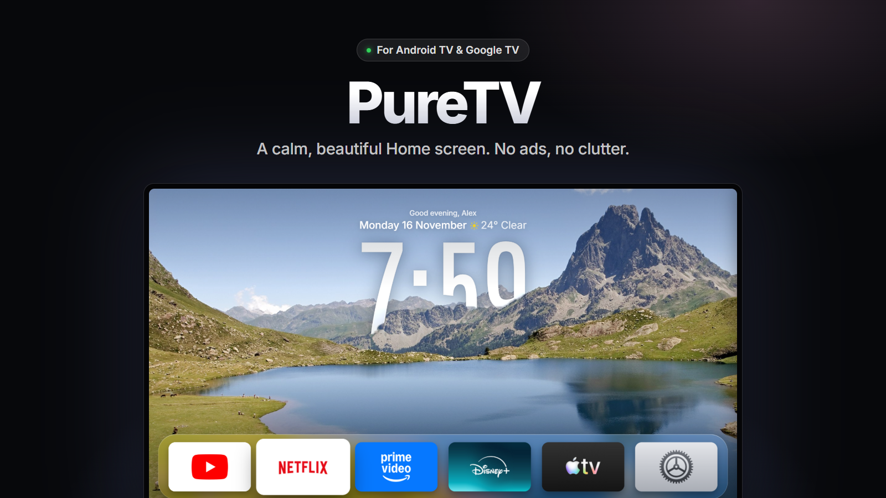
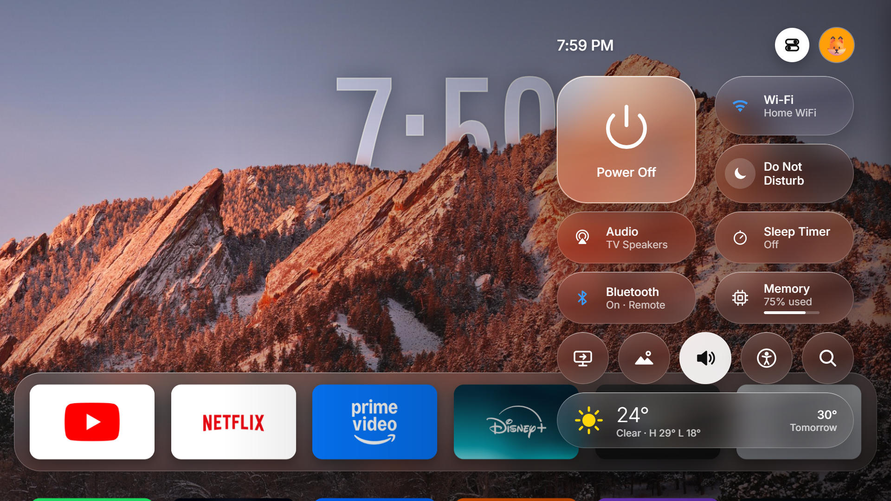
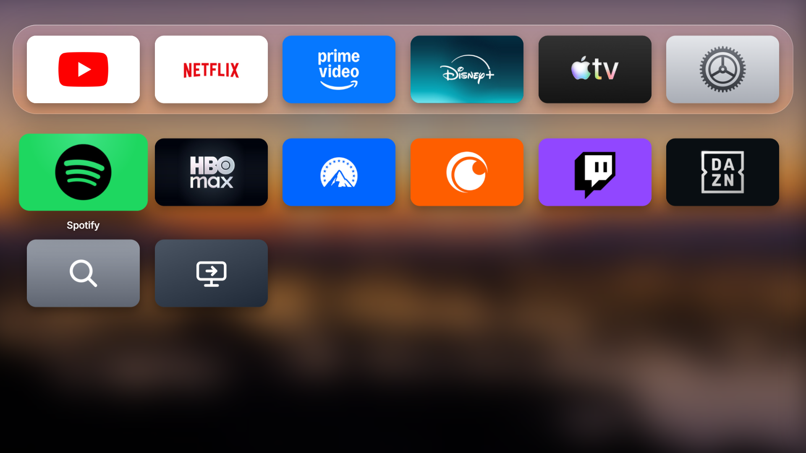
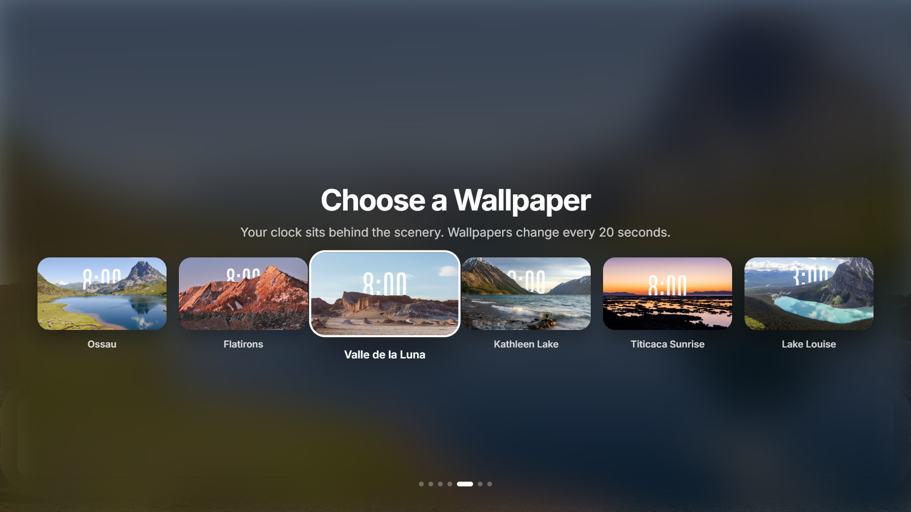

<p align="center"></p>

<p align="center">
  <a href="https://github.com/advik-srivastava/puretv/releases/latest"><b>Download</b></a> ·
  <a href="INSTALL-TV.md"><b>Install guide</b></a> ·
  Made with ❤️ by <a href="https://crazifiedstudios.com"><b>Crazified Studios</b></a>
</p>

PureTV replaces the cluttered Google TV home with a quiet, tvOS-inspired one. You get your apps, a clock that sits behind real landscapes, and Liquid Glass menus. It can also switch off the ads and preloaded junk that slow your TV down, and it can put everything back.

Your apps, accounts and sign-ins are never touched. Nothing is uninstalled.

## A look around

| | |
|:---:|:---:|
|  |  |
| **Control Center** | **All your apps** |
|  |  |
| **Settings** | **Wallpapers** |

## What you get

- **A Home screen that stays out of the way.** Your apps, a big glass clock and a new landscape every 20 seconds.
- **Liquid Glass.** Clear, Frosted or Dark, with smooth motion and soft sounds.
- **Profiles.** Each one has its own name, emoji, top row and hidden apps.
- **A Kids profile.** Approved apps only. YouTube opens YouTube Kids, and Settings stay behind a parent PIN.
- **Control Center.** Inputs, sound, sleep timer, memory and weather in one place.
- **Made for modest TVs.** It's tuned for HD Ready sets like the Acer V Pro 32", and switches to lighter effects on slower ones.
- **Updates that ask first.** When the TV turns on, PureTV looks for a new version and asks you before installing it.

## Install

### The easy way: let Claude do it

On a computer on the same Wi-Fi as your TV, open **Claude Code**: the *Code* tab in the [Claude desktop app](https://claude.ai/download), or `claude` in a terminal. Then paste:

```
Install PureTV on my TV. Follow https://github.com/advik-srivastava/puretv/blob/main/PROMPT.md
```

Claude will:
- tell you how to turn on debugging on the TV, the one thing you do by hand;
- find the TV, back it up, and ask before switching anything off;
- install PureTV and show you the before-and-after numbers.

To undo it later, paste: `Restore my TV with PureTV. Follow https://github.com/advik-srivastava/puretv/blob/main/PROMPT.md`

> The claude.ai chat in a browser can't reach your TV. It has to be Claude Code, which runs on your computer.

### By hand

PureTV works on any **Android TV or Google TV**: TCL, Sony, Xiaomi, Hisense, Philips, Acer, OnePlus, Chromecast with Google TV, Nvidia Shield and others.

**On the TV itself (no computer needed)**
1. Download `PureTV-Home-…apk` from the [latest release](https://github.com/advik-srivastava/puretv/releases/latest). Put it on a USB stick, or use the *Downloader* app on the TV.
2. Install it with a file manager on the TV, then open **PureTV Home** from your apps.
3. Follow the short setup. At the end, turn on the **Remote Helper** so the Home button opens PureTV.

The [install guide](INSTALL-TV.md) has every step, including what to do if Android 14 greys out the Remote Helper switch.

**With a computer: clean up the TV as well**

This also switches off ads, tracking and preloaded apps. You need a computer on the same Wi-Fi with [Python 3](https://www.python.org/downloads/).

1. Download this project (**Code › Download ZIP** at the top of this page) and unzip it.
2. On the TV, open **Settings › System › About**, press OK on **Android TV OS build** seven times, then turn on **USB debugging** in **Developer options**.
3. Open **Start PureTV.bat** (Windows) or run `sh start.sh` (macOS, Linux). Then follow **Back up → Clean → Launcher → Finish**.
4. When it's done, turn USB debugging off again.

## Safe by design

- **It backs up first.** Before anything changes, every app's state and the TV's settings are saved. The first backup is kept forever.
- **Nothing is deleted.** Apps are only switched off, never uninstalled, so their data stays.
- **One press undoes it all.** *Restore TV* switches everything back on, and *Use Google TV's Home Again* takes you back to Google TV in a moment.
- **Essentials are locked.** Core Android, Google Play, the keyboard, Bluetooth, Wi-Fi and HDMI inputs can never be switched off.
- **Updates are signed.** The TV installs an update only if it carries PureTV's own signature, and only after you say yes.

<details>
<summary><b>For developers</b></summary>

```
app/            the computer app: engine (core.py), local server, demo TV, the TV design (ui/tv.html)
launcher/       PureTV Home for the TV: Java sources, ui-src (TV bridge), build.py (no Gradle)
tools/          build_tv_ui.py, render.py (screenshots), make_scene.py (wallpaper cut-outs), make_release.py
tests/          end-to-end test against the demo TV
```

- Preview the TV design: start PureTV and open <http://127.0.0.1:8765/tv.html>. Use the arrow keys, Enter, Esc, and M for Control Center.
- Build the TV app:
  ```bash
  python tools/build_tv_ui.py
  ```
  ```bash
  PURETV_VERSION=2.1 python launcher/build.py
  ```
- To release, attach the APK to a GitHub release tagged `v2.1`. TVs find it by themselves. Keep `~/.puretv/puretv.keystore` safe: updates signed with a different key are refused.

</details>

## Credits

- Design inspired by Apple tvOS. Apple and tvOS are trademarks of Apple Inc.; PureTV is not affiliated with or endorsed by Apple.
- The wallpaper photographs come from Wikimedia Commons under CC BY-SA; the photographers are listed in [CREDITS.md](app/ui/demo/wallpapers/CREDITS.md).
- App logos belong to their owners.
- Licences and acknowledgements are in [NOTICE.md](NOTICE.md).

Help: [crazifiedstudios@gmail.com](mailto:crazifiedstudios@gmail.com) · [crazifiedstudios.com](https://crazifiedstudios.com)
