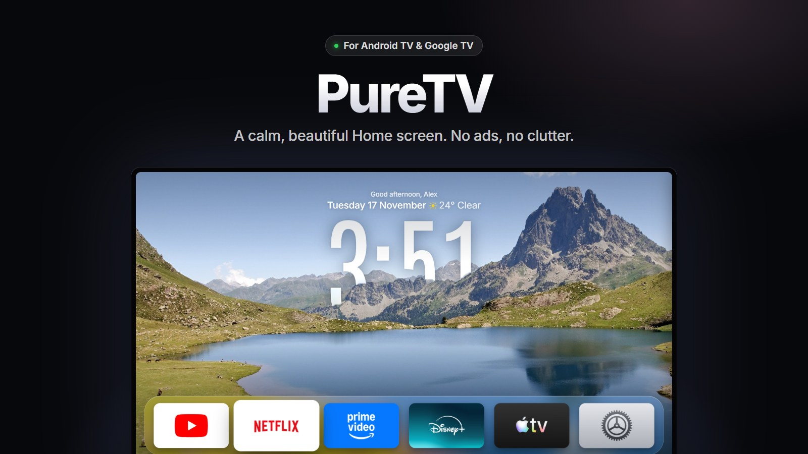
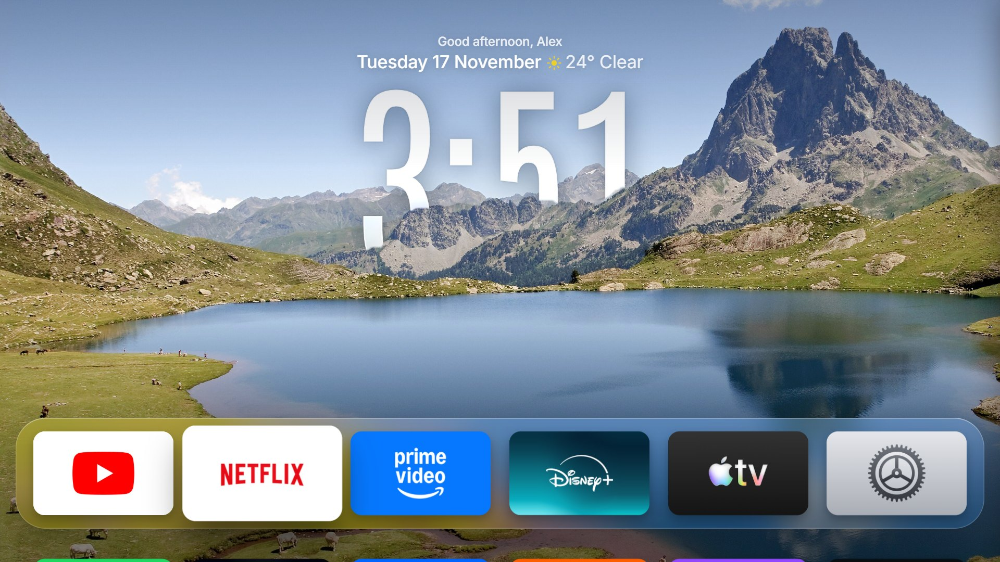
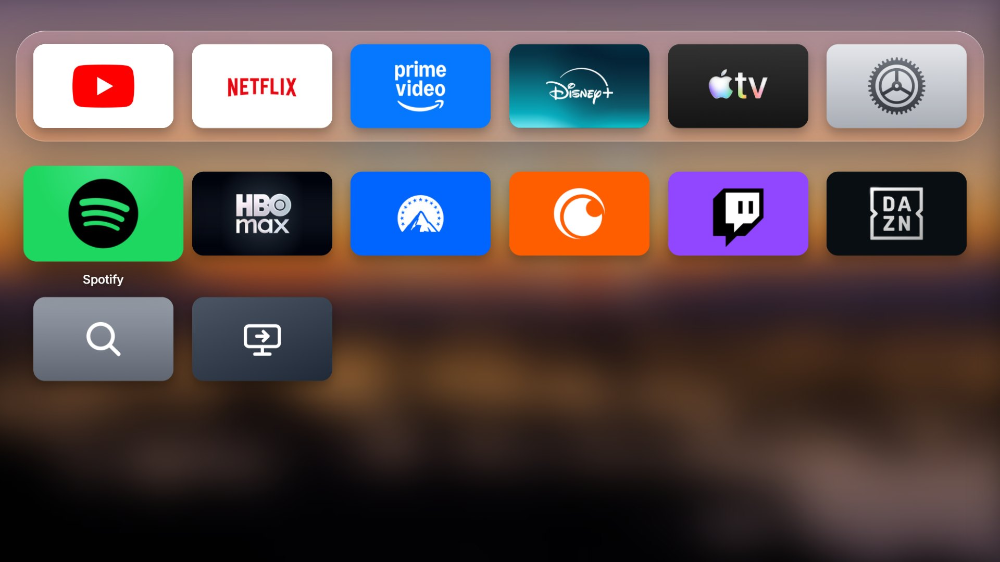
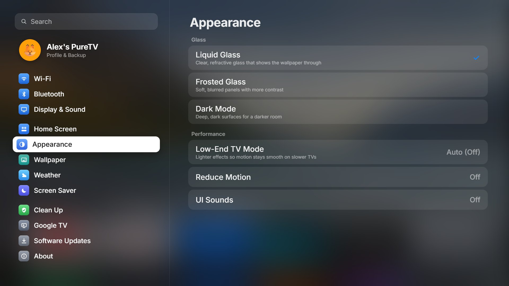

<p align="center"></p>

<p align="center">
  <a href="https://github.com/advik-srivastava/puretv/releases/latest"><b>Download</b></a> ·
  <a href="INSTALL-TV.md"><b>Install guide</b></a> ·
  Made with ❤️ by <a href="https://crazifiedstudios.com"><b>Crazified Studios</b></a>
</p>

PureTV cleans up your Android TV or Google TV:
- switches off the tracking, ads and preloaded junk that slow it down;
- replaces Google TV's cluttered home with a quiet, tvOS-inspired one: your apps, a glass clock behind real landscapes, Liquid Glass menus and Control Center.

It backs everything up first and puts it all back with one command. Your apps, accounts, sign-ins and watch history are never touched, and nothing is uninstalled.

> **AI agents:** to set up, clean or restore a TV with this repository, follow [PROMPT.md](PROMPT.md) step by step.

## A look around

| | |
|:---:|:---:|
|  |  |
| **Home** | **Control Center** |
|  |  |
| **All your apps** | **Settings** |

## What you get

**A clean TV**
- **Tracking and ads off:** telemetry, ad services, data-consent agents, partner auto-installers, store-demo overlays, digital-signage services and vendor "cleaners".
- **Bloat off:** preloaded extras you don't use, from Play Movies and Google's ambient screensaver to preloaded games and duplicate video players. You choose which.
- **Your features stay on:** you tick what you use (voice, Chromecast, using your phone as a remote, Live TV and more). Updates and accessibility always stay on.
- **Less background activity:** background Wi-Fi and Bluetooth scanning are switched off, and only one Home screen runs.

**A calm Home screen**
- A big glass clock behind real landscapes, and a new wallpaper every 20 seconds.
- A top bar with your profile, search, the Home / Apps / Live TV tabs, the weather, Control Center and Settings.
- **Control Center:** power, Wi-Fi, Do Not Disturb, audio, sleep timer, Bluetooth, memory, inputs, screensaver and the weather.
- Five-day weather, Recent Apps, and an app-opening animation.
- **Profiles** with emoji avatars, plus a **Kids profile** with approved apps only and a parent PIN.
- **Liquid Glass** in three styles (Clear, Frosted or Dark), with soft UI sounds.

**Smooth on modest TVs**

PureTV is a native Android app:
- its glass is drawn from pre-blurred images instead of being blurred live;
- nothing redraws at rest;
- it pauses completely while you watch.

At the end of setup, Claude shows a report card measured on your own TV: Home-screen memory, CPU, and how many frames are drawn late, before and after.

**Updates that ask first.** When the TV turns on, PureTV looks for a new version and asks you before installing it.

## Install

### The easy way: paste the link into Claude

On a computer on the same Wi-Fi as your TV, open **Claude Code**: the *Code* tab in the [Claude desktop app](https://claude.ai/download), or `claude` in a terminal. Then paste:

```
Set up my TV with https://github.com/advik-srivastava/puretv
```

Claude asks a few tap-to-answer questions:
- what TV you have;
- which features you use;
- which preloaded apps you never open;
- whether to block ads inside apps.

Then it:
1. backs the TV up;
2. switches off what you don't use;
3. makes PureTV the only Home screen (Google TV's home is switched off, not deleted);
4. restarts the TV;
5. shows the report card.

The only thing you do by hand is turn on debugging on the TV, and Claude tells you how.

To undo everything, paste `Restore my TV with https://github.com/advik-srivastava/puretv`. After a TV firmware update, paste `Check my TV with https://github.com/advik-srivastava/puretv` and Claude switches off anything the update turned back on.

> The claude.ai chat in a browser can't reach your TV. It has to be Claude Code, which runs on your computer.

PureTV works on any **Android TV or Google TV**: Acer, TCL, Sony, Xiaomi, Hisense, Philips, OnePlus, Chromecast with Google TV, Nvidia Shield and others.

### Just the Home screen, no computer

1. Download `PureTV-Home-…apk` from the [latest release](https://github.com/advik-srivastava/puretv/releases/latest). Put it on a USB stick, or use the *Downloader* app on the TV.
2. Install it with a file manager on the TV, then open **PureTV Home** from your apps.

The [install guide](INSTALL-TV.md) has every step. Without a computer, Google TV's home stays on underneath, so for the cleanest, fastest TV use Claude.

## Safe by design

- **It backs up first.** Before anything changes, every app's state and the TV's settings are saved on your computer. The first backup is kept forever.
- **Nothing is deleted.** Apps are only switched off, never uninstalled, so their data and sign-ins stay.
- **What's always kept on:**
  - core Android, Google Play, the keyboard, Wi-Fi, Bluetooth and HDMI inputs;
  - software updates and accessibility;
  - service tools;
  - an app's helper while the app is in use (Netflix's sign-in helper, for example).
- **Checked as it goes.** Apps go off in small batches and the TV is read back after each one. If the Home button doesn't land on PureTV, Google TV's home is switched straight back on.
- **One step undoes it all.** Restore switches everything back on, with Google TV's home and your original settings.
- **Updates are signed.** The TV installs an update only if it carries PureTV's own signature, and only after you say yes.

<details>
<summary><b>For developers</b></summary>

```
app/            the engine (core.py), local server, pretend TV, and the design page (ui/tv.html)
puretv.py       the command line Claude drives (PROMPT.md)
launcher/       PureTV Home for the TV: native Android (Java), build.py (no Gradle)
tools/          build_native_assets.py, render.py (screenshots), preview_native.py, make_scene.py
tests/          end-to-end test against the pretend TV
```

- Preview the design: start PureTV (**Start PureTV.bat** or `sh start.sh`) and open <http://127.0.0.1:8765/tv.html>.
- Try the command line on a pretend TV:
  ```bash
  python puretv.py --demo plan --keep voice
  ```
- Build the TV app:
  ```bash
  python tools/build_native_assets.py
  ```
  ```bash
  PURETV_VERSION=3.1 python launcher/build.py
  ```
- To release, attach the APK twice to a GitHub release tagged `v3.1`: as `PureTV-Home-3.1.apk` and as `purehome.apk` (the fixed name the setup tool falls back to). TVs find it by themselves. Keep `~/.puretv/puretv.keystore` safe: updates signed with a different key are refused.

</details>

## Credits

- Design inspired by Apple tvOS. Apple and tvOS are trademarks of Apple Inc.; PureTV is not affiliated with or endorsed by Apple.
- The wallpaper photographs come from Wikimedia Commons under CC BY-SA; the photographers are listed in [CREDITS.md](app/ui/demo/wallpapers/CREDITS.md).
- App logos belong to their owners.
- Licences and acknowledgements are in [NOTICE.md](NOTICE.md).

Help: [crazifiedstudios@gmail.com](mailto:crazifiedstudios@gmail.com) · [crazifiedstudios.com](https://crazifiedstudios.com)
