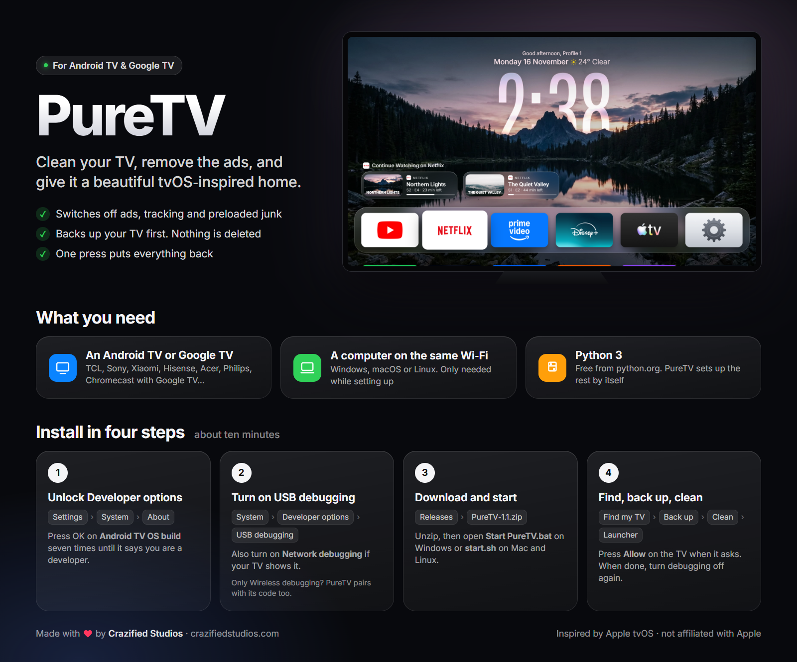
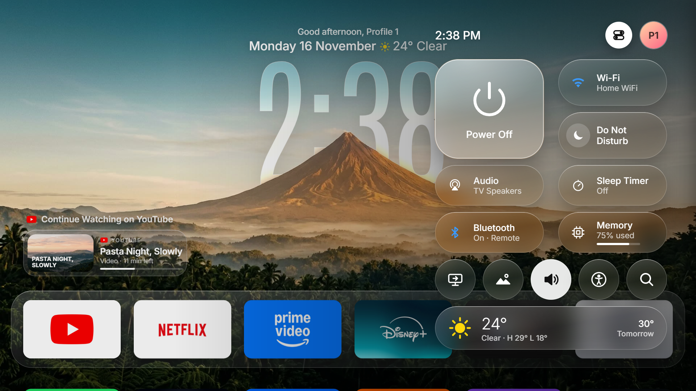

<p align="center"></p>

# PureTV

Made with ❤️ by **[Crazified Studios](https://crazifiedstudios.com)** · Help: [crazifiedstudios@gmail.com](mailto:crazifiedstudios@gmail.com)

**[⬇ Download the latest release](https://github.com/advik-srivastava/puretv/releases/latest)** · Design inspired by Apple tvOS (not affiliated with Apple)

| Control Center | Settings | All apps |
|---|---|---|
|  |  |  |

Clean up an Android TV / Google TV over Wi-Fi and give it a calm home screen.
Nothing is uninstalled, nothing is rooted, and one button puts everything back.

## Install

PureTV works on any **Android TV or Google TV** (TCL, Sony, Xiaomi, Hisense, Philips, Acer, OnePlus, Chromecast
with Google TV, Google TV Streamer, Nvidia Shield and more). Samsung, LG, Roku and other non-Android TVs have no
debugging port, so nothing can be installed on them (see cleanyour.tv/not-android for their privacy switches).

You need a computer on the same Wi-Fi as the TV, with [Python 3](https://www.python.org/downloads/).

1. **Download** `PureTV-<version>.zip` from the [latest release](https://github.com/advik-srivastava/puretv/releases/latest)
   and unzip it. (The ZIP already has the TV launcher inside. *Code › Download ZIP* works too: PureTV then fetches
   the launcher from the latest release by itself.)
2. **On the TV:** Settings › System › About › press OK on *Android TV OS build* seven times, then
   Settings › System › Developer options › turn on **USB debugging** (and *Network debugging* if shown).
3. **Start PureTV:** double-click **Start PureTV.bat** on Windows, or run `sh start.sh` on macOS and Linux.
   Press **Find my TV automatically** and accept "Allow USB debugging?" on the TV.
   - *TV only offers Wireless debugging with a pairing code* (Chromecast with Google TV, Google TV Streamer):
     open **My TV only offers Wireless debugging** and type the pairing address, code and address the TV shows.
     PureTV pairs with Google's own adb tool, as cleanyourtv does.
4. **Follow the steps:** Back up → Clean → Launcher → Finish. Nothing is uninstalled; *Restore TV* puts everything back.
5. **When done:** turn debugging off on the TV again, reboot it, and press *Check debugging is off*.

After that the TV launcher updates itself from new releases (hold OK on Settings › *Check for updates*).

**Try the TV design first:** start PureTV and open <http://127.0.0.1:8765/tv.html>
(arrow keys, Enter, Esc, M for Control Center). That page is a design preview; the launcher installed on the TV
is the simpler PureTV Home until the tvOS-style launcher is built into the APK.

## Use it

1. Double-click **Start PureTV.bat** (first run sets itself up; needs Python 3).
2. Follow the five steps in the browser page that opens:
   **Connect → Back up → Clean → Launcher → Finish**.
   No TV nearby? Click *Try it with a demo TV* on the first screen.

## What each step does

| Step | On the TV |
|---|---|
| **Back up** | Records every app's on/off state, the Home app, animation and screensaver settings, plus a full settings dump, in `~/.puretv/backups/`. The first backup is the original and is never overwritten. |
| **Clean** | `pm disable-user --user 0` on the apps you tick, in small batches, then reads the TV back to confirm. Suggestions come from 494 community-tested lists (`app/knowledge.json`). |
| **Launcher** | Installs PureTV Home (24 KB, no internet permission), starts it, and only then switches the stock launcher off. If Home does not land on PureTV, the stock launcher is switched straight back on. |
| **Restore** | Re-enables exactly what was on at backup time, returns Home and settings. What was already off before stays off. |

## Following cleanyourtv's own steps

| cleanyourtv (PROMPT.md) | PureTV |
|---|---|
| Find the TV on the Wi-Fi | **Find my TV automatically**: ARP table, then this computer's /24 network, keeping only devices that answer ADB's greeting (no prompt on the TV) |
| Back up first | Every app's state, Home, animation, screensaver and Private DNS settings, plus a full settings dump |
| Ask before touching what you use | The Clean list and the TV's own setup checklist |
| Disable in small batches, read the TV back | Batches of 4 with a pause, then `pm list packages -e` |
| Keep launcherx on Google TV where profiles need it | **Keep Google TV's home** option on the Launcher step |
| Optional ad-blocking DNS | **Block ads inside apps** (AdGuard via Private DNS), undone by Restore |
| After a firmware update (check.py) | **Check after an update**: finds what came back on and switches it off again |
| Close network ADB (adb-closed.py) | **Check debugging is off**: only a refused connection counts as closed |

## Safety guards (never overridable from the UI)

- Core Android, Play services/Store, keyboard, Bluetooth, WebView and networking are locked.
- Anything that answers the Home button is only touched by the Launcher step.
- Apps that drive HDMI/AV/tuner inputs, or that open Settings or inputs, are kept on.
- The setup wizard is never disabled while it owns the saved Wi-Fi network.
- Package names are validated before they reach the TV's shell.

## Layout

```
app/core.py        the engine (ADB, backup, guards, clean, launcher handover, restore)
app/server.py      local web server, this computer only (127.0.0.1:8765)
app/demo.py        pretend TV for trying the app and for tests
app/ui/            the interface
launcher/          PureTV Home source (plain Java) and build.py (no Gradle)
tests/test_core.py end-to-end test against the demo TV
tools/build_knowledge.py  regenerates knowledge.json from a cleanyourtv checkout
```

Rebuild the launcher after editing it: `python launcher/build.py`.

On the TV: hold OK (or press Menu) on an app to move or hide it; hold OK on Settings for the launcher's own menu.

Credits and licence: see [NOTICE.md](NOTICE.md).

## Releasing an update

PureTV Home updates itself from your GitHub releases (Hold OK on Settings › *Check for updates*, or
*Automatic updates*, which checks once a day).

1. The update source is `launcher/res/values/strings.xml` › `update_repo` (`advik-srivastava/puretv`).
2. For each new version: `PURETV_VERSION=1.2 python launcher/build.py`, then `python -I tools/make_release.py 1.2`,
   and create a GitHub release tagged `v1.2` with `launcher/dist/purehome.apk` and `release/PureTV-1.2.zip` attached.
3. The TV finds it, downloads it, refuses it unless it is signed with the same key
   (`~/.puretv/puretv.keystore` — keep it safe, a new key means updates are refused), and installs it with
   Android's own installer. The first update asks for confirmation on the TV.
